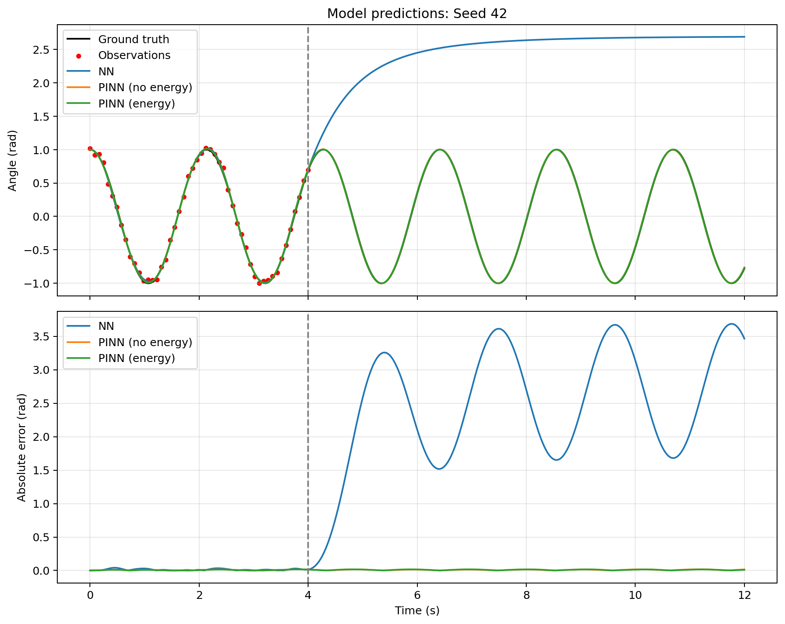
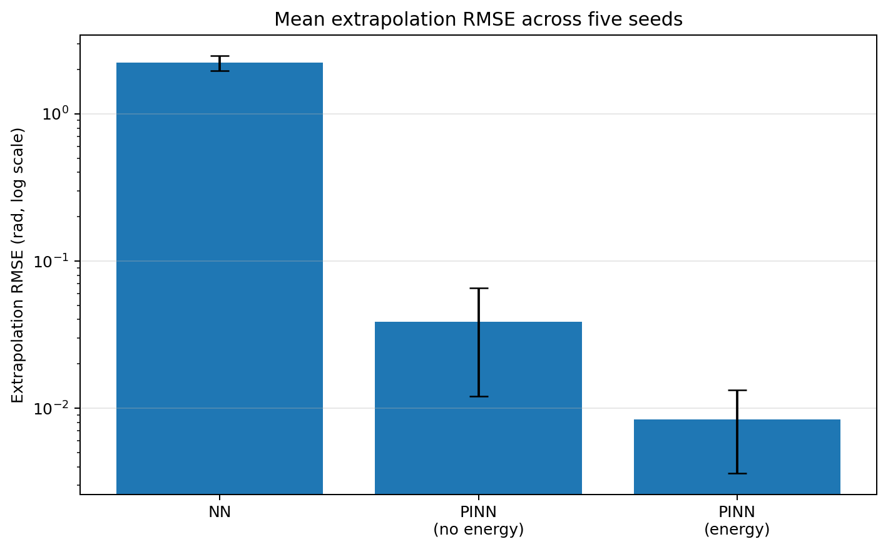

# Neural Networks vs. Physics-Informed Neural Networks: The Nonlinear Pendulum

This project compares a standard neural network (NN) with physics-informed neural networks (PINNs) on a nonlinear pendulum. Each model observes the pendulum only during the first four seconds and is evaluated on its ability to predict the trajectory through 12 seconds.

The central question is whether incorporating the governing differential equation—and an additional energy-conservation penalty—improves prediction beyond the observed data and makes training more efficient.

## Physical model

We model an ideal, undamped pendulum using

$$
\theta''(t) + \frac{g}{L}\sin\theta(t) = 0,
$$

with parameters and initial conditions

- Gravitational acceleration: $g = 9.81\,\mathrm{m/s^2}$
- Pendulum length: $L = 1\,\mathrm{m}$
- Initial angle: $\theta(0) = 1\,\mathrm{rad}$
- Initial angular velocity: $\theta'(0) = 0$

A high-accuracy numerical solution from SciPy's `solve_ivp` provides the reference trajectory. The training data consist of 50 angle observations over $t\in[0,4]$ seconds with independent Gaussian noise (standard deviation 0.05 rad). Models are evaluated against the noise-free reference trajectory.

## Models

All three models use the same fully connected neural network architecture: three hidden layers of 64 neurons, `tanh` activations, and one scalar output $\hat\theta(t)$. Training uses Adam with a learning rate of $10^{-3}$. For each random seed, the models start from identical network weights and use the same noisy observations.

### 1. Standard NN

The ordinary NN minimizes the observation error and the initial-condition error:

$$
\mathcal L_{\mathrm{NN}} = \mathcal L_{\mathrm{data}} + \lambda_{\mathrm{IC}}\mathcal L_{\mathrm{IC}}.
$$

### 2. PINN without energy loss

The PINN additionally penalizes violations of the pendulum equation:

$$
\mathcal L_{\mathrm{physics}} = \frac{1}{N_c}\sum_{i=1}^{N_c}\left(\hat\theta''(t_i)+\frac{g}{L}\sin\hat\theta(t_i)\right)^2.
$$

The derivatives are obtained using PyTorch automatic differentiation. The experiment uses 200 fixed collocation points distributed across **the entire interval** $[0,12]$ seconds.

$$
\mathcal L_{\mathrm{PINN}} = \mathcal L_{\mathrm{data}} + \lambda_{\mathrm{IC}}\mathcal L_{\mathrm{IC}} + \lambda_{\mathrm{physics}}\mathcal L_{\mathrm{physics}}.
$$

### 3. PINN with energy loss

The third model adds a penalty for deviations from the pendulum's initial mechanical energy:

$$
E(t) = \frac12 L^2\hat\theta'(t)^2 + gL\bigl(1-\cos\hat\theta(t)\bigr),
\qquad
E_0 = gL\bigl(1-\cos(1)\bigr).
$$

$$
\mathcal L_{\mathrm{energy}} = \frac{1}{N_c}\sum_{i=1}^{N_c}\left(\frac{E(t_i)-E_0}{E_0}\right)^2.
$$

The loss is

$$
\mathcal L_{\mathrm{PINN+E}} = \mathcal L_{\mathrm{PINN}} + \lambda_{\mathrm{energy}}\mathcal L_{\mathrm{energy}}.
$$

The weights used are $\lambda_{\mathrm{IC}}=1$, $\lambda_{\mathrm{physics}}=0.01$, and, when enabled, $\lambda_{\mathrm{energy}}=0.1$.

Energy conservation follows mathematically from the undamped pendulum ODE, so the added energy penalty is **redundant as a physical constraint**. Here, we test whether this extra training signal helps optimization.

**Why the energy penalty helps:** In earlier runs without it, the PINN often produced trajectories that decayed toward the stable equilibrium $\theta=0$ outside the observation interval. Since the constant-zero solution satisfies the pendulum ODE, this can produce a small physics residual over much of that interval and leave the optimizer stalled for many epochs. The energy penalty discourages this behavior: a stationary pendulum at $\theta=0$ has zero energy, whereas our initial conditions require $E_0>0$.

## Experiment

- **Observation interval:** 0–4 s
- **Evaluation interval:** 0–12 s; extrapolation RMSE is calculated on 4–12 s
- **Physics enforcement interval (PINNs):** 0–12 s
- **Random seeds:** 42, 43, 44, 45, 46
- **Maximum epochs:** 100,000
- **Collocation points:** 200, fixed

Training may stop before 100,000 epochs when the specified loss thresholds are satisfied at five consecutive checks, 500 epochs apart. The NN stops based on data and initial-condition losses. Both PINN variants use the same data, initial-condition, physics, and **energy diagnostic** thresholds for stopping, even when the energy loss has zero weight in optimization. Reaching the maximum epoch budget does not imply convergence.

**Important:** The PINNs receive physics constraints throughout the 4–12 s evaluation interval. Their success here demonstrates prediction beyond *observed data*, not extrapolation beyond the domain where physics is enforced. In a separate experiment, direct PINN predictions deteriorated beyond the physics-enforcement interval.

## Results

Five-seed results (mean ± sample standard deviation):

| Model | Training RMSE (rad) | Extrapolation RMSE (rad) | Epochs | Training time (s) |
|---|---:|---:|---:|---:|
| NN | 0.0241 ± 0.0058 | 2.2216 ± 0.2546 | 4,400 ± 2,329 | 7.7 ± 3.7 |
| PINN (no energy) | 0.0118 ± 0.0036 | 0.0387 ± 0.0267 | 78,000 ± 30,177 | 309.7 ± 116.1 |
| PINN (energy) | 0.0105 ± 0.0020 | **0.0084 ± 0.0048** | **25,999 ± 8,529** | **104.0 ± 31.9** |

*Training RMSE is computed against the noise-free numerical reference on 0–4 s, not against the noisy observations used in the loss function.*

### Visual results





The trajectory figure shows the NN's poor prediction beyond the observed data and the close agreement of the two PINN trajectories over the physics-constrained interval. The logarithmic RMSE chart makes the difference between the two PINN variants visible alongside the much larger NN error.


Across these five seeds, adding the energy penalty:

- Reduced mean extrapolation RMSE by approximately **78%** compared with the PINN without energy loss.
- Reduced mean training time by approximately **66%** (309.7 s to 104.0 s).
- Satisfied the stopping criteria in **5/5** runs, compared with **2/5** without energy. The other three no-energy runs reached the 100,000-epoch limit.

These are preliminary results from five seeds. The PINN without energy can also learn an accurate trajectory; the key observed benefit of the energy penalty is faster and more consistent convergence under this setup. The models do not use the same stopping criteria as the ordinary NN, so training times are not a controlled comparison of compute required to reach the same *prediction* accuracy.

## Project files

| File | Purpose |
|---|---|
| `pendulum.py` | Solves the pendulum ODE and generates noisy observations |
| `model.py` | Defines the shared neural network architecture |
| `train_nn.py` | Trains the standard NN |
| `train_pinn.py` | Trains PINNs with configurable physics and energy-loss weights |
| `train_pinn_gradnorm.py` | Optional experimental adaptive loss weighting (GradNorm) |
| `main.py` | Provides single-seed Show Mode and multi-seed Run Mode, with plotting, evaluation, and optional CSV output |
| `tune_pinn.py` | Optional hyperparameter-tuning experiments |

## Running the experiment

Requires Python and the packages listed in `requirements.txt` (`numpy`, `scipy`, `torch`, and `matplotlib`).

```bash
python -m pip install -r requirements.txt
python main.py
```

The optional hyperparameter tuning script also uses `optuna` (install separately if needed).

### Show Mode vs. Run Mode

Set these options near the top of `main.py`:

```python
SHOW_MODE = True
SHOW_SEED = 42
SEEDS = [42, 43, 44, 45, 46]
RUN_GRADNORM = False
```

| Setting | Show Mode (`SHOW_MODE = True`) | Run Mode (`SHOW_MODE = False`) |
|---|---|---|
| Seeds | Only `SHOW_SEED` (default: 42) | All seeds in `SEEDS` (default: five) |
| Training | Trains each selected model from scratch | Trains each selected model from scratch |
| Console output | Per-model RMSE, epochs, and time | Per-model results plus averages and standard deviations |
| Figures | Trajectory predictions and absolute errors | Same figure for the first seed, plus mean extrapolation RMSE bar chart |
| CSV files | **Does not create, overwrite, or append to CSVs** | Writes individual runs, paired PINN comparison, and summary statistics |

**Show Mode** is useful for inspecting one seed's results without changing existing CSV files. It **does not** load a previously trained model; it retrains the models each time. **Run Mode** is intended for multi-seed comparisons and overwrites its three output CSVs when started, so save or rename old results before rerunning.

With `RUN_GRADNORM = False`, both modes compare the standard NN, PINN without energy loss, and PINN with energy loss. Setting `RUN_GRADNORM = True` adds the optional adaptive-weighting model in either mode. Other configurable parameters include `T_END`, `EPOCHS`, `LAMBDA_PHYSICS`, and `LAMBDA_ENERGY`.

Set `SAVE_FIGURES = True` to save figures to `figures/`. In Show Mode, the trajectory figure is saved for the selected seed without modifying CSV files. In Run Mode, the first seed's trajectory figure and the multi-seed RMSE chart are saved. Existing figure files of the same name are overwritten. The images above come from the completed five-seed experiment; to create new figures, rerun the relevant mode.

In Run Mode, the default CSV files are:

- `results_12s.csv`: metrics, actual trained epochs, convergence status, training time, and loss weights for every model/seed, appended after each training run.
- `energy_comparison_12s.csv`: per-seed accuracy, epochs, time differences, and convergence status for PINNs with and without energy loss, appended after each seed.
- `summary_12s.csv`: final means, standard deviations, and counts of converged runs, saved after all runs finish.

A `Converged` value of `True` means the method met its prescribed loss thresholds; `False` means it reached its epoch budget without meeting them. An empty value means the optional trainer did not report convergence. The reported convergence is based on training diagnostics, **not** the ground-truth prediction RMSE.

## Possible extensions

- Study convergence and loss histories for runs that reach the maximum epoch budget.
- Compare direct PINN predictions with numerical ODE integration starting from the PINN-predicted state at the end of the physics interval.
- Evaluate other physics-enforcement horizons and collocation strategies.
- Explore adaptive loss weighting, including the optional GradNorm implementation.

## Takeaway

A standard neural network can fit noisy pendulum observations while failing to predict the motion beyond them. Enforcing the governing ODE produces much more accurate predictions over the constrained interval. Although energy conservation is already implied by the ODE, including an energy penalty substantially improved optimization speed and consistency in this experiment.
